# Jarkom-Modul-3-2026-K-32

Laporan resmi Praktikum Modul 3 Komunikasi Data & Jaringan Komputer 2026
**Curtain Protocol: Shibuya Incident**

| | |
|---|---|
| Kelompok | K-32 |
| Prefix IP | `192.227` |
| Domain | `k32.com` |
| Anggota | Anargya Shafa Setiyadi Putra - 5027251081 |
|         | Irsa Fairuza - 5027251115

---

## Daftar Isi

- [Topologi](#topologi)
- [Pembagian Alamat IP](#pembagian-alamat-ip)
- [Struktur Repository](#struktur-repository)
- [Catatan Lingkungan GNS3](#catatan-lingkungan-gns3)
- [Soal 1 – Routing dasar, IP forwarding & NAT](#soal-1--routing-dasar-ip-forwarding--nat)
- [Soal 2 – DHCP Server tengen](#soal-2--dhcp-server-tengen)
- [Soal 3 – DHCP Relay jichi](#soal-3--dhcp-relay-jichi)
- [Soal 4 – Dua pool DHCP di Network 2](#soal-4--dua-pool-dhcp-di-network-2)
- [Soal 5 – Short lease, long lease, DNS & domain-search](#soal-5--short-lease-long-lease-dns--domain-search)
- [Soal 6 – Fixed address kugisaki](#soal-6--fixed-address-kugisaki)
- [Soal 7 – Verifikasi konfigurasi seluruh client](#soal-7--verifikasi-konfigurasi-seluruh-client)
- [Soal 8 – Packet capture DORA](#soal-8--packet-capture-dora)
- [Soal 9 – Simulasi gangguan relay](#soal-9--simulasi-gangguan-relay)
- [Soal 10 – Autostart setelah restart](#soal-10--autostart-setelah-restart)
- [Kendala & Solusi](#kendala--solusi)

---

## Topologi


Topologi terdiri atas satu router (**jichi**) yang menghubungkan NAT (internet) dan empat jaringan:

| Network | Peran | Interface jichi | Node |
|---|---|---|---|
| WAN | Internet (NAT) | `eth0` | NAT1 |
| Network 1 | DMZ | `eth1` | utahime, shoko, gojo |
| Network 2 | Divisi A (DHCP relay) | `eth2` | itadori, fushiguro, zenin, okkotsu |
| Network 3 | Divisi B (DHCP relay) | `eth3` | ino, kusakabe, miwa, kugisaki |
| Network 4 | Data Center | `eth4` | tengen, geto, maki, panda, nanami, todo, kirara, yaga, inumaki |

Image Docker yang digunakan:
- `ardhptr21/debinet:latest` untuk router dan seluruh server
- `ardhptr21/alpinet:latest` untuk seluruh client

Topologi (32 node dan 31 link) dibuat otomatis memakai script Python melalui REST API GNS3, yaitu [`scripts/gns3_jujutsu_topology.py`](scripts/gns3_jujutsu_topology.py).

---

## Pembagian Alamat IP

Semua subnet memakai mask `/24` (`255.255.255.0`).

### Router

| Interface | Alamat | Keterangan |
|---|---|---|
| jichi `eth0` | DHCP dari NAT (`192.168.122.x`) | WAN |
| jichi `eth1` | `192.227.1.1` | Gateway Network 1 |
| jichi `eth2` | `192.227.2.1` | Gateway Network 2 |
| jichi `eth3` | `192.227.3.1` | Gateway Network 3 |
| jichi `eth4` | `192.227.4.1` | Gateway Network 4 |

### Host statis

| Node | Peran | IP | Gateway |
|---|---|---|---|
| utahime | DNS Master | `192.227.1.2` | `192.227.1.1` |
| shoko | DNS Slave | `192.227.1.3` | `192.227.1.1` |
| gojo | Public Reverse Proxy | `192.227.1.4` | `192.227.1.1` |
| inumaki | Database Slave | `192.227.4.2` | `192.227.4.1` |
| geto | Internal Load Balancer | `192.227.4.3` | `192.227.4.1` |
| maki | Worker frontend | `192.227.4.4` | `192.227.4.1` |
| panda | Worker frontend | `192.227.4.5` | `192.227.4.1` |
| nanami | Worker API utama | `192.227.4.6` | `192.227.4.1` |
| todo | Worker API utama | `192.227.4.7` | `192.227.4.1` |
| kirara | Worker API cadangan | `192.227.4.8` | `192.227.4.1` |
| yaga | Database Master | `192.227.4.9` | `192.227.4.1` |
| tengen | DHCP Server | `192.227.4.10` | `192.227.4.1` |

### Client (DHCP)

MAC address setiap client ditetapkan secara tetap oleh script `dhcp.sh`, supaya DHCP server dapat mengenali kelompok client melalui *class* berbasis MAC.

| Client | MAC | Kebijakan | Rentang / Alamat | Lease |
|---|---|---|---|---|
| itadori | `02:00:00:00:a1:01` | Pool 1 (Dev) | `192.227.2.10 – .35` | 600 s |
| fushiguro | `02:00:00:00:a1:02` | Pool 1 (Dev) | `192.227.2.10 – .35` | 600 s |
| zenin | `02:00:00:00:a2:01` | Pool 2 (Support) | `192.227.2.70 – .95` | 600 s |
| okkotsu | `02:00:00:00:a2:02` | Pool 2 (Support) | `192.227.2.70 – .95` | 600 s |
| ino | `02:00:00:00:b3:01` | Short lease | `192.227.3.10 – .89` | 1800 s |
| kusakabe | `02:00:00:00:b3:02` | Short lease | `192.227.3.10 – .89` | 1800 s |
| miwa | `02:00:00:00:b3:03` | Long lease | `192.227.3.100 – .199` | 43200 s |
| kugisaki | `02:00:00:00:b3:04` | Fixed address | `192.227.3.99` | 600 s |

---

## Struktur Repository

```
.
├── README.md
├── assets/                         # screenshot hasil pengujian
└── scripts/
    ├── gns3_jujutsu_topology.py    # pembuat topologi otomatis via API GNS3
    ├── server/soal1.sh             # IP statis jichi & seluruh server
    ├── jichi/
    │   ├── soal3.sh                # DHCP relay
    │   ├── soal9.sh                # simulasi gangguan relay (stop/start)
    │   └── soal10.sh               # autostart
    ├── tengen/
    │   ├── soal2.sh … soal7.sh     # konfigurasi isc-dhcp-server bertahap
    │   ├── cek7.sh                 # pemeriksa kebijakan pool & bentrok alamat
    │   ├── soal8.sh                # tcpdump DORA
    │   └── soal10.sh               # autostart
    └── client/dhcp.sh              # permintaan DHCP dari client
```

Di dalam node, seluruh script disimpan di `/root` sesuai ketentuan praktikum. Salinan cadangannya disimpan di `/etc/network/`.

> Output terminal pada laporan ini sebagian dipersingkat agar fokus pada baris yang menjadi bukti. Output lengkap dapat dilihat pada screenshot di folder `assets/`.

---

## Catatan Lingkungan GNS3

Dua perilaku node Docker di GNS3 berpengaruh langsung pada cara pengerjaan:

1. **Hanya `/etc/network` yang persisten.** Saat node di-restart atau project dibuka ulang, container dibuat ulang. Akibatnya IP yang dipasang dengan perintah `ip`, paket yang diinstal, isi `/root`, dan file lease ikut hilang. Karena itu setiap script dicadangkan ke `/etc/network/`, dan setiap script mengecek serta menginstal ulang paket bila belum ada.
2. **Tidak ada systemd.** Perintah `systemctl enable` tidak berlaku. Saat container start, GNS3 menjalankan `ifup -a` (versi busybox) terhadap `/etc/network/interfaces`, dan mekanisme inilah yang dipakai untuk autostart di soal 10.

Jika project dibuka ulang sebelum autostart terpasang, urutan pemulihan manualnya:

```bash
# 1. jichi (selalu pertama, karena semua jalur melewati jichi)
cp -n /etc/network/*.sh /root/ ; bash /root/soal1.sh ; bash /root/soal3.sh
# 2. setiap server
cp -n /etc/network/*.sh /root/ ; bash /root/soal1.sh
# 3. tengen
bash /root/soal7.sh
# 4. setiap client
cp -n /etc/network/dhcp.sh /root/ ; sh /root/dhcp.sh
```

---

## Soal 1 – Routing dasar, IP forwarding & NAT

### Tujuan
Memulihkan konektivitas dasar. jichi mendapat WAN dari NAT melalui `eth0` dan menjadi gateway Network 1–4 melalui `eth1`–`eth4`. IPv4 forwarding dan source NAT diaktifkan, lalu seluruh host infrastruktur diberi IP statis.

### Langkah
Satu script yang sama, [`scripts/server/soal1.sh`](scripts/server/soal1.sh), dijalankan di jichi dan di 12 server. Script membaca `hostname` untuk menentukan perannya.

- **Di jichi**, script:
  - meminta IP DHCP dari NAT di `eth0`;
  - memasang `192.227.N.1/24` di `eth1`–`eth4`;
  - mengaktifkan `net.ipv4.ip_forward=1`;
  - menambahkan aturan `MASQUERADE` untuk `192.227.0.0/16` yang keluar lewat `eth0`.
- **Di server**, script memasang IP sesuai tabel, menambahkan default route ke gateway subnetnya, dan mengisi nameserver `192.168.122.1` (dipakai untuk persiapan instalasi paket).

```bash
bash /root/soal1.sh
cp /root/soal1.sh /etc/network/soal1.sh
```

Inti konfigurasi di jichi:

```bash
for n in 1 2 3 4; do
  ip addr replace 192.227.$n.1/24 dev eth$n
  ip link set eth$n up
done
sysctl -w net.ipv4.ip_forward=1
iptables -t nat -A POSTROUTING -s 192.227.0.0/16 -o eth0 -j MASQUERADE
```

### Hasil Uji

**jichi**: interface, routing, forwarding, dan NAT.

```
root@jichi:~# ip -br addr; ip route; cat /proc/sys/net/ipv4/ip_forward; iptables -t nat -S POSTROUTING
lo               UNKNOWN        127.0.0.1/8 ::1/128
eth0             UNKNOWN        192.168.122.2/24 fe80::42:dfff:fe69:7000/64
eth1             UNKNOWN        192.227.1.1/24 fe80::42:dfff:fe69:7001/64
eth2             UNKNOWN        192.227.2.1/24 fe80::42:dfff:fe69:7002/64
eth3             UNKNOWN        192.227.3.1/24 fe80::42:dfff:fe69:7003/64
eth4             UNKNOWN        192.227.4.1/24 fe80::42:dfff:fe69:7004/64
default via 192.168.122.1 dev eth0
192.168.122.0/24 dev eth0 proto kernel scope link src 192.168.122.2
192.227.1.0/24 dev eth1 proto kernel scope link src 192.227.1.1
192.227.2.0/24 dev eth2 proto kernel scope link src 192.227.2.1
192.227.3.0/24 dev eth3 proto kernel scope link src 192.227.3.1
192.227.4.0/24 dev eth4 proto kernel scope link src 192.227.4.1
1
-P POSTROUTING ACCEPT
-A POSTROUTING -s 192.227.0.0/16 -o eth0 -j MASQUERADE
```

**Contoh server (panda)**: ping ke gateway dan ke internet.

```
eth0             UNKNOWN        192.227.4.5/24
Gateway: 192.227.4.1
--- 192.227.4.1 ping statistics ---
3 packets transmitted, 3 received, 0% packet loss, time 2006ms
--- 8.8.8.8 ping statistics ---
3 packets transmitted, 3 received, 0% packet loss, time 2003ms
PING google.com (172.217.194.139) 56(84) bytes of data.
--- google.com ping statistics ---
3 packets transmitted, 3 received, 0% packet loss, time 2003ms
```

**Kesimpulan:**
- Setiap interface jichi sudah memegang alamat gateway yang sesuai.
- `ip_forward` bernilai `1`, dan aturan MASQUERADE aktif.
- Host di Network 4 berhasil menjangkau gateway, `8.8.8.8`, dan `google.com`. Hasil yang sama didapat di seluruh server.


---

## Soal 2 – DHCP Server tengen

### Tujuan
Mengonfigurasi `isc-dhcp-server` di tengen dengan alamat `192.227.4.10`. Network 4 dideklarasikan sebagai subnet lokal tanpa pool dinamis, sedangkan Network 2 dan Network 3 diberi scope DHCP.

### Langkah
1. **Menyesuaikan IP tengen ke `192.227.4.10`.** Pembagian awal memberi tengen `.4.2` dan inumaki `.4.10`, sehingga keduanya ditukar:

    ```bash
    sed -i -E 's/tengen\)( +)IP=\$P\.4\.2 /tengen)\1IP=$P.4.10 /; s/inumaki\)( +)IP=\$P\.4\.10 /inumaki)\1IP=$P.4.2 /' /root/soal1.sh
    ip addr flush dev eth0
    bash /root/soal1.sh
    cp /root/soal1.sh /etc/network/soal1.sh
    ```

2. **Menginstal dan mengonfigurasi DHCP server** dengan [`scripts/tengen/soal2.sh`](scripts/tengen/soal2.sh):
    - `INTERFACESv4="eth0"` di `/etc/default/isc-dhcp-server`;
    - `subnet 192.227.4.0` dideklarasikan **kosong** (tanpa `range`). Deklarasi ini wajib ada supaya dhcpd mengenali subnet interface-nya sendiri. Tanpanya, dhcpd gagal dengan error *"No subnet declaration for eth0"*;
    - scope Network 2 dan Network 3, masing-masing dengan `range`, `routers`, dan `broadcast-address`.

Potongan `dhcpd.conf`:

```
subnet 192.227.4.0 netmask 255.255.255.0 {
}
subnet 192.227.2.0 netmask 255.255.255.0 {
    range 192.227.2.10 192.227.2.100;
    option routers 192.227.2.1;
    option broadcast-address 192.227.2.255;
}
subnet 192.227.3.0 netmask 255.255.255.0 {
    range 192.227.3.10 192.227.3.100;
    option routers 192.227.3.1;
    option broadcast-address 192.227.3.255;
}
```

### Hasil Uji

IP tengen setelah penyesuaian:

```
root@tengen:~# bash /root/soal1.sh
eth0             UNKNOWN        192.227.4.10/24
Gateway: 192.227.4.1
--- 192.227.4.1 ping statistics ---
3 packets transmitted, 3 received, 0% packet loss, time 2272ms
--- 8.8.8.8 ping statistics ---
3 packets transmitted, 3 received, 0% packet loss, time 2218ms
--- google.com ping statistics ---
3 packets transmitted, 3 received, 0% packet loss, time 2218ms
```

Validasi konfigurasi dan status service:

```
===== Validasi konfigurasi =====
Internet Systems Consortium DHCP Server 4.4.3-P1
Config file: /etc/dhcp/dhcpd.conf
Database file: /var/lib/dhcp/dhcpd.leases
PID file: /var/run/dhcpd.pid
Launching IPv4 server only.
Starting ISC DHCPv4 server: dhcpd.
===== Status service =====
Status of ISC DHCPv4 server: dhcpd is running.
root  491  0.0  0.0  9520  6920 ?  Ss  07:59  0:00 /usr/sbin/dhcpd -4 -q -cf /etc/dhcp/dhcpd.conf eth0
```

**Kesimpulan:** `dhcpd -t` tidak menampilkan error apa pun, termasuk *"No subnet declaration"*, dan service berjalan di `eth0`. Pesan `invoke-rc.d: policy-rc.d denied execution of start` saat instalasi adalah perilaku normal di container: service memang tidak otomatis dinyalakan saat diinstal, sehingga script menyalakannya sendiri.


---

## Soal 3 – DHCP Relay jichi

### Tujuan
Broadcast DHCP dari Network 2 dan 3 tidak bisa menyeberang router. Karena itu jichi dikonfigurasi sebagai DHCP relay menuju tengen (`192.227.4.10`), memakai `eth2` dan `eth3`.

### Langkah
[`scripts/jichi/soal3.sh`](scripts/jichi/soal3.sh) menginstal `isc-dhcp-relay`, lalu menjalankan:

```bash
dhcrelay -4 -id eth2 -id eth3 -iu eth4 192.227.4.10
```

- `-id eth2`, `-id eth3`: interface *downstream*, yaitu sisi client (Network 2 dan 3).
- `-iu eth4`: interface *upstream*, yaitu sisi DHCP server (Network 4).

`eth4` wajib didaftarkan sebagai upstream. Tanpanya, request memang terkirim ke tengen, tetapi balasan dari tengen tidak diterima relay sehingga tidak pernah sampai ke client.

Di sisi client, [`scripts/client/dhcp.sh`](scripts/client/dhcp.sh) menghapus IP lama, memasang MAC tetap, lalu meminta lease dengan `udhcpc`.

### Hasil Uji

**jichi**: relay aktif dengan peran interface yang benar.

```
Requesting: eth2 as upstream: N downstream: Y
Requesting: eth3 as upstream: N downstream: Y
Requesting: eth4 as upstream: Y downstream: N
Internet Systems Consortium DHCP Relay Agent 4.4.3-P1
===== Konfigurasi relay =====
SERVERS="192.227.4.10"
INTERFACES=""
OPTIONS="-id eth2 -id eth3 -iu eth4"
===== Proses relay =====
root  502  0.0  0.0  5988  3460 ?  Ss  10:23  0:00 dhcrelay -4 -id eth2 -id eth3 -iu eth4 192.227.4.10
===== Cek jalur ke tengen =====
2 packets transmitted, 2 received, 0% packet loss, time 1140ms
```

**itadori (Network 2)**: mendapat lease melalui relay.

```
itadori:~# sh /root/dhcp.sh
udhcpc: started, v1.37.0
udhcpc: broadcasting discover
udhcpc: broadcasting select for 192.227.2.10, server 192.227.4.10
udhcpc: lease of 192.227.2.10 obtained from 192.227.4.10, lease time 600
===== Hasil lease =====
eth0             UNKNOWN        192.227.2.10/24
default via 192.227.2.1 dev eth0 metric 83254
192.227.2.0/24 dev eth0 proto kernel scope link src 192.227.2.10
--- 192.227.2.1 ping statistics ---
3 packets transmitted, 3 received, 0% packet loss, time 2320ms
```

**Kesimpulan:** client di subnet lain mendapat lease dari `192.227.4.10` dengan gateway yang sesuai. Client Network 3 juga mendapat lease melalui relay yang sama, seperti ditunjukkan pada hasil uji soal 5–7.


---

## Soal 4 – Dua pool DHCP di Network 2

### Tujuan
Memisahkan alokasi tim Dev (itadori, fushiguro) ke Pool 1 `192.227.2.10–.35` dan tim Support (zenin, okkotsu) ke Pool 2 `192.227.2.70–.95`. Rentang `.36–.69` tidak boleh dialokasikan.

### Langkah
Seluruh client berada di subnet yang sama, sehingga digunakan **DHCP class berbasis MAC address**. Masalahnya, MAC container dapat berubah saat node dibuat ulang. Karena itu `dhcp.sh` memasang MAC tetap (`ip link set eth0 address ...`) sebelum meminta lease.

Konfigurasi di tengen ([`scripts/tengen/soal4.sh`](scripts/tengen/soal4.sh)):

```
class "pool1" { match hardware; }
subclass "pool1" 1:02:00:00:00:a1:01;   # itadori
subclass "pool1" 1:02:00:00:00:a1:02;   # fushiguro

class "pool2" { match hardware; }
subclass "pool2" 1:02:00:00:00:a2:01;   # zenin
subclass "pool2" 1:02:00:00:00:a2:02;   # okkotsu

subnet 192.227.2.0 netmask 255.255.255.0 {
    option routers 192.227.2.1;
    option broadcast-address 192.227.2.255;
    pool {
        range 192.227.2.10 192.227.2.35;
        allow members of "pool1";
    }
    pool {
        range 192.227.2.70 192.227.2.95;
        allow members of "pool2";
    }
}
```

- `match hardware` mencocokkan field hardware milik client. Prefiks `1:` pada `subclass` menandakan tipe hardware Ethernet.
- Rentang `.36–.69` tidak dimasukkan ke pool mana pun, sehingga otomatis tidak pernah dialokasikan.

### Hasil Uji

Validasi konfigurasi:

```
===== Validasi konfigurasi =====
Internet Systems Consortium DHCP Server 4.4.3-P1
Stopping ISC DHCPv4 server: dhcpd.
Launching IPv4 server only.
Starting ISC DHCPv4 server: dhcpd.
Status of ISC DHCPv4 server: dhcpd is running.
```

**itadori (Pool 1)**:

```
udhcpc: lease of 192.227.2.10 obtained from 192.227.4.10, lease time 600
    link/ether 02:00:00:00:a1:01 brd ff:ff:ff:ff:ff:ff
eth0             UNKNOWN        192.227.2.10/24 fe80::ff:fe00:a101/64
default via 192.227.2.1 dev eth0 metric 83254
```

**okkotsu (Pool 2)**:

```
udhcpc: lease of 192.227.2.71 obtained from 192.227.4.10, lease time 600
    link/ether 02:00:00:00:a2:02 brd ff:ff:ff:ff:ff:ff
eth0             UNKNOWN        192.227.2.71/24 fe80::ff:fe00:a202/64
default via 192.227.2.1 dev eth0 metric 83267
```

Lease yang tercatat di tengen (`/var/lib/dhcp/dhcpd.leases`):

```
lease 192.227.2.70 {
  hardware ethernet 02:00:00:00:a2:01;     # zenin
lease 192.227.2.71 {
  hardware ethernet 02:00:00:00:a2:02;     # okkotsu
```

**Kesimpulan:** itadori dan fushiguro mendapat alamat di Pool 1 (`.2.10`, `.2.11`), sedangkan zenin dan okkotsu mendapat alamat di Pool 2 (`.2.70`, `.2.71`). Tidak ada alamat di rentang `.36–.69` yang dialokasikan.


---

## Soal 5 – Short lease, long lease, DNS & domain-search

### Tujuan
Di Network 3, ino dan kusakabe mendapat short lease 1800 detik (pool `.3.10–.89`), dan miwa mendapat long lease 43200 detik (pool `.3.100–.199`). Client juga menerima DNS `192.227.1.2` dan `192.227.1.3`, serta domain-search `k32.com`.

### Langkah
Pola class berbasis MAC yang sama dipakai lagi. Setiap pool diberi `default-lease-time` dan `max-lease-time` masing-masing ([`scripts/tengen/soal5.sh`](scripts/tengen/soal5.sh)):

```
class "short-lease" { match hardware; }
subclass "short-lease" 1:02:00:00:00:b3:01;   # ino
subclass "short-lease" 1:02:00:00:00:b3:02;   # kusakabe
class "long-lease" { match hardware; }
subclass "long-lease" 1:02:00:00:00:b3:03;    # miwa

subnet 192.227.3.0 netmask 255.255.255.0 {
    option routers 192.227.3.1;
    option broadcast-address 192.227.3.255;
    option domain-name-servers 192.227.1.2, 192.227.1.3;
    option domain-search "k32.com";
    pool {
        range 192.227.3.10 192.227.3.89;
        allow members of "short-lease";
        default-lease-time 1800;
        max-lease-time 1800;
    }
    pool {
        range 192.227.3.100 192.227.3.199;
        allow members of "long-lease";
        default-lease-time 43200;
        max-lease-time 43200;
    }
}
```

Di sisi client, `udhcpc` dijalankan dengan `-O search -O domain`. Tanpa opsi itu, `udhcpc` tidak meminta opsi 119 (domain-search) ke server, sehingga baris `search` tidak akan muncul di `resolv.conf`.

### Hasil Uji

**ino (short lease)**:

```
udhcpc: lease of 192.227.3.10 obtained from 192.227.4.10, lease time 1800
    link/ether 02:00:00:00:b3:01 brd ff:ff:ff:ff:ff:ff
eth0             UNKNOWN        192.227.3.10/24 fe80::ff:fe00:b301/64
default via 192.227.3.1 dev eth0 metric 83270
----- /etc/resolv.conf -----
search k32.com
nameserver 192.227.1.2
nameserver 192.227.1.3
--- 192.227.3.1 ping statistics ---
3 packets transmitted, 3 received, 0% packet loss
```

Lease yang tercatat di tengen. Selisih `starts` dan `ends` menunjukkan durasi lease (waktu dalam UTC):

```
lease 192.227.3.10 {
  starts 3 2026/10/14 10:50:38;
  ends 3 2026/10/14 11:20:38;
  hardware ethernet 02:00:00:00:b3:01;     # ino      -> 30 menit
lease 192.227.3.11 {
  starts 3 2026/10/14 10:51:01;
  ends 3 2026/10/14 11:21:01;
  hardware ethernet 02:00:00:00:b3:02;     # kusakabe -> 30 menit
lease 192.227.3.100 {
  starts 3 2026/10/14 10:51:10;
  ends 3 2026/10/14 22:51:10;
  hardware ethernet 02:00:00:00:b3:03;     # miwa     -> 12 jam
```

| Client | IP | Durasi lease | Pool |
|---|---|---|---|
| ino | `192.227.3.10` | 30 menit | short ✅ |
| kusakabe | `192.227.3.11` | 30 menit | short ✅ |
| miwa | `192.227.3.100` | 12 jam | long ✅ |

**Kesimpulan:** lease time dan pool berbeda sesuai kelas client, dan opsi DNS serta domain-search diterima oleh client. DNS `192.227.1.2/.3` baru dapat dipakai untuk resolusi nama setelah DNS server di utahime dan shoko dikonfigurasi.


---

## Soal 6 – Fixed address kugisaki

### Tujuan
kugisaki selalu mendapat alamat `192.227.3.99` berdasarkan MAC address-nya.

### Langkah
Alamat `.3.99` berada di celah antara pool short (`.10–.89`) dan pool long (`.100–.199`), sehingga berada di luar seluruh pool dinamis. Deklarasi `host` ditambahkan ([`scripts/tengen/soal6.sh`](scripts/tengen/soal6.sh)):

```
host kugisaki {
    hardware ethernet 02:00:00:00:b3:04;
    fixed-address 192.227.3.99;
    option routers 192.227.3.1;
    option domain-name-servers 192.227.1.2, 192.227.1.3;
    option domain-search "k32.com";
}
```

### Hasil Uji

Validasi di tengen:

```
===== Validasi konfigurasi =====
Internet Systems Consortium DHCP Server 4.4.3-P1
Starting ISC DHCPv4 server: dhcpd.
Status of ISC DHCPv4 server: dhcpd is running.
===== Reservasi kugisaki =====
host kugisaki {
    hardware ethernet 02:00:00:00:b3:04;
    fixed-address 192.227.3.99;
    option routers 192.227.3.1;
    option domain-name-servers 192.227.1.2, 192.227.1.3;
    option domain-search "k32.com";
}
```

**kugisaki**, permintaan pertama:

```
kugisaki:~# sh /root/dhcp.sh
udhcpc: broadcasting select for 192.227.3.99, server 192.227.4.10
udhcpc: lease of 192.227.3.99 obtained from 192.227.4.10, lease time 600
    link/ether 02:00:00:00:b3:04 brd ff:ff:ff:ff:ff:ff
eth0             UNKNOWN        192.227.3.99/24 fe80::ff:fe00:b304/64
default via 192.227.3.1 dev eth0 metric 83280
search k32.com
nameserver 192.227.1.2
nameserver 192.227.1.3
--- 192.227.3.1 ping statistics ---
3 packets transmitted, 3 received, 0% packet loss, time 2246ms
```

**kugisaki**, renew lease:

```
kugisaki:~# udhcpc -i eth0 -n -q -O search -O domain
udhcpc: broadcasting select for 192.227.3.99, server 192.227.4.10
udhcpc: lease of 192.227.3.99 obtained from 192.227.4.10, lease time 600
eth0             UNKNOWN        192.227.3.99/24 fe80::ff:fe00:b304/64
```

**Kesimpulan:** kugisaki menerima alamat reservasi `192.227.3.99`, baik pada permintaan pertama maupun setelah renew. Fixed address tidak dicatat di `dhcpd.leases`; ini memang perilaku normal isc-dhcp-server untuk reservasi.


---

## Soal 7 – Verifikasi konfigurasi seluruh client

### Tujuan
Memastikan setiap client menerima mask `/24`, gateway, broadcast, DNS `192.227.1.2/.3`, dan domain-search yang benar. Lease juga dicocokkan dengan `dhcpd.leases` untuk memastikan tidak ada alamat yang bentrok atau berada di luar kebijakan pool.

### Langkah
1. Saat pemeriksaan, ditemukan bahwa Network 2 masih memakai DNS `192.168.122.1` tanpa domain-search. Opsi Network 2 disamakan dengan Network 3 menggunakan [`scripts/tengen/soal7.sh`](scripts/tengen/soal7.sh).
2. Setiap client meminta lease ulang, lalu konfigurasinya ditampilkan dengan:

    ```sh
    ip addr show eth0 | grep -E "ether|inet " ; ip route ; cat /etc/resolv.conf
    ```

3. Dibuat script pemeriksa [`scripts/tengen/cek7.sh`](scripts/tengen/cek7.sh), yang:
    - membaca status terakhir setiap IP di `dhcpd.leases`;
    - mencocokkan MAC setiap lease aktif dengan pool yang seharusnya;
    - mendeteksi IP atau MAC yang terduplikasi;
    - memastikan `.3.99` tidak ikut terpakai oleh pool dinamis.

### Hasil Uji

Opsi per subnet setelah diperbarui:

```
subnet 192.227.2.0 netmask 255.255.255.0 {
    option routers 192.227.2.1;
    option broadcast-address 192.227.2.255;
    option domain-name-servers 192.227.1.2, 192.227.1.3;
    option domain-search "k32.com";
subnet 192.227.3.0 netmask 255.255.255.0 {
    option routers 192.227.3.1;
    option broadcast-address 192.227.3.255;
    option domain-name-servers 192.227.1.2, 192.227.1.3;
    option domain-search "k32.com";
```

Contoh client Divisi A (**okkotsu**) dan Divisi B (**ino**):

```
===== okkotsu =====
    link/ether 02:00:00:00:a2:02 brd ff:ff:ff:ff:ff:ff
    inet 192.227.2.71/24 brd 192.227.2.255 scope global eth0
default via 192.227.2.1 dev eth0 metric 83267
search k32.com
nameserver 192.227.1.2
nameserver 192.227.1.3

===== ino =====
    link/ether 02:00:00:00:b3:01 brd ff:ff:ff:ff:ff:ff
    inet 192.227.3.10/24 brd 192.227.3.255 scope global eth0
default via 192.227.3.1 dev eth0 metric 83270
search k32.com
nameserver 192.227.1.2
nameserver 192.227.1.3
```

Pencocokan lease dengan kebijakan pool (`bash /root/cek7.sh` di tengen):

```
IP               MAC                 KLIEN      STATUS    POOL           HASIL
192.227.2.10     02:00:00:00:a1:01   itadori    active    .2.10-.2.35    OK
192.227.2.11     02:00:00:00:a1:02   fushiguro  active    .2.10-.2.35    OK
192.227.2.70     02:00:00:00:a2:01   zenin      active    .2.70-.2.95    OK
192.227.2.71     02:00:00:00:a2:02   okkotsu    active    .2.70-.2.95    OK
192.227.3.10     02:00:00:00:b3:01   ino        active    .3.10-.3.89    OK
192.227.3.11     02:00:00:00:b3:02   kusakabe   active    .3.10-.3.89    OK
192.227.3.100    02:00:00:00:b3:03   miwa       active    .3.100-.3.199  OK

Bentrok alamat : TIDAK ADA (setiap IP & MAC aktif unik)
Fixed address  : .3.99 tidak dipakai pool dinamis (khusus kugisaki)
KESIMPULAN     : semua lease sesuai kebijakan pool
```

**Kesimpulan:** semua client menerima mask `/24`, broadcast `.255`, gateway sesuai subnet, DNS `192.227.1.2/.3`, dan `search k32.com`. Ketujuh lease dinamis berada di pool yang benar, tanpa bentrok alamat, dan kugisaki memegang `.3.99` lewat reservasi.

> Lease short (30 menit) dapat kedaluwarsa bila pemeriksaan dilakukan terlalu lama setelah client meminta lease. Dalam kasus itu, client perlu menjalankan `dhcp.sh` ulang sebelum `cek7.sh`.


---

## Soal 8 – Packet capture DORA

### Tujuan
Membuktikan proses DHCP berjalan sesuai protokol, dengan urutan DHCPDISCOVER → DHCPOFFER → DHCPREQUEST → DHCPACK. Dari paket yang tertangkap juga diidentifikasi alamat server, alamat yang diberikan, lease time, dan field `giaddr`.

### Langkah
[`scripts/tengen/soal8.sh`](scripts/tengen/soal8.sh) dijalankan di tengen dan menunggu 4 paket DHCP:

```bash
tcpdump -i eth0 -n -vv -c 4 -l 'udp port 67 or udp port 68' 2>&1 | tee /root/soal8_capture.txt
```

Selama tcpdump menunggu, itadori (Network 2) meminta lease baru dengan `sh /root/dhcp.sh`.

### Hasil Uji

```
22:35:21.666226 IP 192.227.4.1.67 > 192.227.4.10.67: BOOTP/DHCP, Request from 02:00:00:00:a1:01, length 300, hops 1, xid 0x981a035b
          Gateway-IP 192.227.2.1
          Client-Ethernet-Address 02:00:00:00:a1:01
            DHCP-Message (53), length 1: Discover
22:35:21.666632 IP 192.227.4.10.67 > 192.227.2.1.67: BOOTP/DHCP, Reply, length 300, hops 1, xid 0x981a035b
          Your-IP 192.227.2.10
          Gateway-IP 192.227.2.1
            DHCP-Message (53), length 1: Offer
            Server-ID (54), length 4: 192.227.4.10
            Lease-Time (51), length 4: 600
            Subnet-Mask (1), length 4: 255.255.255.0
            Default-Gateway (3), length 4: 192.227.2.1
            Domain-Name-Server (6), length 8: 192.227.1.2,192.227.1.3
            BR (28), length 4: 192.227.2.255
            Unknown (119), length 9: 3.107.51.50.3.99.111.109.0
22:35:21.679161 IP 192.227.4.1.67 > 192.227.4.10.67: BOOTP/DHCP, Request from 02:00:00:00:a1:01, length 300, hops 1, xid 0x981a035b
          Gateway-IP 192.227.2.1
            DHCP-Message (53), length 1: Request
            Requested-IP (50), length 4: 192.227.2.10
            Server-ID (54), length 4: 192.227.4.10
22:35:21.680220 IP 192.227.4.10.67 > 192.227.2.1.67: BOOTP/DHCP, Reply, length 300, hops 1, xid 0x981a035b
          Your-IP 192.227.2.10
          Gateway-IP 192.227.2.1
            DHCP-Message (53), length 1: ACK
            Server-ID (54), length 4: 192.227.4.10
            Lease-Time (51), length 4: 600
4 packets captured
4 packets received by filter
0 packets dropped by kernel
```

| # | Pesan | Arah |
|---|---|---|
| 1 | Discover | `192.227.4.1` (relay) → `192.227.4.10` |
| 2 | Offer | `192.227.4.10` → `192.227.2.1` (giaddr) |
| 3 | Request | `192.227.4.1` (relay) → `192.227.4.10` |
| 4 | ACK | `192.227.4.10` → `192.227.2.1` (giaddr) |

| Field | Nilai | Sumber |
|---|---|---|
| Alamat server | `192.227.4.10` | `Server-ID (54)` |
| Alamat yang diberikan | `192.227.2.10` | `Your-IP` |
| Lease time | `600` detik | `Lease-Time (51)` |
| giaddr | `192.227.2.1` | `Gateway-IP` |

### Analisis
- Keempat paket memiliki `xid 0x981a035b` yang sama, sehingga merupakan satu transaksi DHCP.
- Discover diterima jichi melalui **eth2** (`192.227.2.1`). Sebagai relay, jichi mengisi `giaddr = 192.227.2.1` dan meneruskannya ke tengen dari interface `eth4` (`192.227.4.1`), dengan `hops 1`.
- Dari `giaddr` itu tengen mengetahui bahwa client berasal dari `192.227.2.0/24`, lalu memilih alamat dari pool Network 2. Offer dan ACK dikirim ke `giaddr`, kemudian diteruskan jichi ke client.
- Nilai `giaddr` sesuai dengan interface jichi yang menerima request dari subnet client.
- Opsi `Unknown (119)` adalah domain-search yang dikodekan dalam ASCII: `107 51 50` = `k32` dan `99 111 109` = `com`, sehingga isinya `k32.com`.


---

## Soal 9 – Simulasi gangguan relay

### Tujuan
Menghentikan DHCP relay, mencatat gejala di client, lalu memulihkan relay dan membuktikan bahwa client kembali mendapat alamat dari pool yang benar dengan gateway semula.

### Langkah
[`scripts/jichi/soal9.sh`](scripts/jichi/soal9.sh) mempunyai dua mode:

```bash
bash /root/soal9.sh stop    # hentikan dhcrelay
bash /root/soal9.sh start   # jalankan ulang relay (soal3.sh)
```

Setelah relay dihentikan, itadori meminta lease baru. Relay kemudian dipulihkan dan itadori meminta lease lagi.

### Hasil Uji

**1. Relay dihentikan (jichi):**

```
root@jichi:~# bash /root/soal9.sh stop
===== Status relay setelah dihentikan =====
dhcrelay TIDAK berjalan (relay mati)
```

**2. Gejala di client (itadori):**

```
itadori:~# sh /root/dhcp.sh
udhcpc: started, v1.37.0
udhcpc: broadcasting discover
udhcpc: broadcasting discover
udhcpc: broadcasting discover
udhcpc: broadcasting discover
udhcpc: broadcasting discover
udhcpc failed to get a DHCP lease
udhcpc: no lease, failing
===== Hasil lease =====
    link/ether 02:00:00:00:a1:01 brd ff:ff:ff:ff:ff:ff
eth0             UNKNOWN        fe80::ff:fe00:a101/64
ping: usage error: Destination address required
```

**3. Relay dipulihkan (jichi):**

```
root@jichi:~# bash /root/soal9.sh start
Requesting: eth2 as upstream: N downstream: Y
Requesting: eth3 as upstream: N downstream: Y
Requesting: eth4 as upstream: Y downstream: N
===== Proses relay =====
root  532  0.0  0.0  5988  3456 ?  Ss  22:54  0:00 dhcrelay -4 -id eth2 -id eth3 -iu eth4 192.227.4.10
===== Cek jalur ke tengen =====
2 packets transmitted, 2 received, 0% packet loss, time 1112ms
```

**4. Client mendapat alamat kembali (itadori):**

```
itadori:~# sh /root/dhcp.sh
udhcpc: broadcasting select for 192.227.2.10, server 192.227.4.10
udhcpc: lease of 192.227.2.10 obtained from 192.227.4.10, lease time 600
eth0             UNKNOWN        192.227.2.10/24 fe80::ff:fe00:a101/64
default via 192.227.2.1 dev eth0 metric 83254
--- 192.227.2.1 ping statistics ---
3 packets transmitted, 3 received, 0% packet loss, time 2284ms
```

| Kondisi | Relay | Client |
|---|---|---|
| Gangguan | `dhcrelay` mati | Discover terkirim 5 kali tanpa balasan Offer; tanpa IPv4 dan tanpa gateway |
| Pulih | `dhcrelay` aktif kembali | `192.227.2.10` (Pool 1), gateway `192.227.2.1` |

**Kesimpulan:** DHCPDISCOVER adalah broadcast dan tidak dapat melewati router. Selama relay mati, DHCP server tetap berjalan tetapi tidak menerima request apa pun dari Network 2. Setelah relay dipulihkan, client langsung mendapat alamat yang sama dari pool yang benar, karena kebijakan class di tengen tidak berubah.


---

## Soal 10 – Autostart setelah restart

### Tujuan
DHCP server di tengen dan DHCP relay di jichi harus menyala otomatis setelah node di-restart, dan seluruh kebijakan DHCP harus tetap berlaku.

### Langkah
Karena tidak ada systemd (lihat [Catatan Lingkungan GNS3](#catatan-lingkungan-gns3)), autostart dibangun dengan cara berikut ([`scripts/jichi/soal10.sh`](scripts/jichi/soal10.sh)):

1. **`/etc/network/autostart.sh`** memasang IP (`soal1.sh`), lalu menyalakan layanan sesuai node:
    - jichi menjalankan `soal3.sh` (relay);
    - tengen menunggu koneksi internet tersedia (diperlukan bila paket harus diinstal ulang), lalu menjalankan `soal7.sh` (konfigurasi DHCP lengkap dari soal 4–7).
2. **Hook boot di `/etc/network/interfaces`.** File ini dibaca GNS3 lewat `ifup -a` setiap container start:

    ```
    auto lo
    iface lo inet manual
        up setsid /etc/network/autostart.sh > /var/log/autostart.log 2>&1 < /dev/null &
    ```

3. `update-rc.d isc-dhcp-relay defaults` (jichi) dan `update-rc.d isc-dhcp-server defaults` (tengen), sebagai cara standar Debian untuk mengaktifkan service saat boot.

Isi `autostart.sh`:

```bash
#!/bin/bash
echo "===== autostart $(hostname) $(date) ====="
sleep 3
cp -n /etc/network/*.sh /root/ 2>/dev/null
case "$(hostname)" in
  jichi)
    bash /root/soal1.sh
    bash /root/soal3.sh
    ;;
  tengen)
    bash /root/soal1.sh
    for i in $(seq 1 60); do ping -c1 -W1 8.8.8.8 >/dev/null 2>&1 && break; sleep 2; done
    bash /root/soal7.sh
    ;;
esac
echo "===== autostart selesai $(date) ====="
```

#### Mengapa `inet manual`, bukan `inet loopback`
Percobaan pertama memakai `iface lo inet loopback`, dan setelah restart autostart **tidak berjalan**:

```
root@jichi:~# ps -o lstart= -p 1; ip -br addr; ip route | grep default; ps aux | grep [d]hcrelay; tail -5 /var/log/autostart.log
Wed Oct 14 23:11:21 2026
lo               UNKNOWN        127.0.0.1/8 ::1/128
eth0             UNKNOWN        fe80::42:dfff:fe69:7000/64
eth1             UNKNOWN        fe80::42:dfff:fe69:7001/64
eth2             UNKNOWN        fe80::42:dfff:fe69:7002/64
eth3             UNKNOWN        fe80::42:dfff:fe69:7003/64
eth4             UNKNOWN        fe80::42:dfff:fe69:7004/64
tail: cannot open '/var/log/autostart.log' for reading: No such file or directory
```

Dengan metode `loopback`, busybox `ifup` mencoba menambahkan `127.0.0.1` ke `lo`. Alamat itu sudah ada, sehingga langkah tersebut gagal, interface dianggap gagal naik, dan perintah `up` (hook autostart) tidak pernah dijalankan. Setelah diganti menjadi `inet manual`, busybox tidak melakukan konfigurasi alamat dan langsung menjalankan perintah `up`.

```bash
sed -i 's/^iface lo inet loopback$/iface lo inet manual/' /etc/network/interfaces
```

### Hasil Uji

Setelah jichi dan tengen di-restart (Stop, lalu Start), tanpa menjalankan perintah apa pun secara manual:

**jichi:**

```
Wed Oct 14 23:13:00 2026
eth0             UNKNOWN        192.168.122.121/24
eth1             UNKNOWN        192.227.1.1/24 fe80::42:dfff:fe69:7001/64
lo               UNKNOWN        127.0.0.1/8 ::1/128
eth2             UNKNOWN        192.227.2.1/24 fe80::42:dfff:fe69:7002/64
eth3             UNKNOWN        192.227.3.1/24 fe80::42:dfff:fe69:7003/64
eth4             UNKNOWN        192.227.4.1/24 fe80::42:dfff:fe69:7004/64
default via 192.168.122.1 dev eth0 metric 87240
root  130  0.0  0.0  5988  3328 ?  Ss  23:13  0:00 dhcrelay -4 -id eth2 -id eth3 -iu eth4 192.227.4.10
```

**tengen:**

```
Wed Oct 14 23:13:12 2026
eth0             UNKNOWN        192.227.4.10/24 fe80::42:94ff:fe19:5e00/64
default via 192.227.4.1 dev eth0
Status of ISC DHCPv4 server: dhcpd is running.
...
===== autostart selesai Wed Oct 14 23:13:35 UTC 2026 =====
```

Proses relay mendapat **PID baru (130) dengan waktu start 23:13**, sama dengan waktu boot container. Sebelum restart, PID-nya 532 dengan waktu start 22:54. Ini membuktikan relay dinyalakan oleh autostart, bukan dijalankan manual.

Kebijakan DHCP setelah restart. Client meminta lease ulang, lalu `cek7.sh` dijalankan di tengen:

```
IP               MAC                 KLIEN      STATUS    POOL           HASIL
192.227.2.10     02:00:00:00:a1:01   itadori    active    .2.10-.2.35    OK
192.227.2.70     02:00:00:00:a2:01   zenin      active    .2.70-.2.95    OK
192.227.3.11     02:00:00:00:b3:02   kusakabe   active    .3.10-.3.89    OK
192.227.3.100    02:00:00:00:b3:03   miwa       active    .3.100-.3.199  OK

Bentrok alamat : TIDAK ADA (setiap IP & MAC aktif unik)
Fixed address  : .3.99 tidak dipakai pool dinamis (khusus kugisaki)
KESIMPULAN     : semua lease sesuai kebijakan pool
```

| Kebijakan | Client | Hasil setelah restart |
|---|---|---|
| Pool 1 | itadori | `192.227.2.10` ✅ |
| Pool 2 | zenin | `192.227.2.70` ✅ |
| Short lease | kusakabe | `192.227.3.11` ✅ |
| Long lease | miwa | `192.227.3.100` ✅ |
| Fixed address | kugisaki | `192.227.3.99` ✅ |

**Kesimpulan:** setelah restart, relay dan DHCP server menyala sendiri dengan IP dan gateway yang benar, dan seluruh kebijakan DHCP tetap berlaku.

> File `dhcpd.leases` ikut kosong setelah container dibuat ulang. Tabel `cek7.sh` baru terisi setelah client meminta lease kembali.


---


## Soal 11
Utahime dan Shoko ditugaskan membangun sistem penamaan domain resmi agar seluruh pos tidak perlu menghafal alamat IP mentah. Konfigurasikan BIND9 pada utahime sebagai DNS Master dan shoko sebagai DNS Slave untuk mengelola domain jujutsu.<xxxx>.com. Atur SOA record, NS delegasi untuk kedua server, dan terapkan allow-transfer dari Master ke Slave. Pastikan file zona berhasil tersinkronisasi otomatis ke shoko saat nomor serial di utahime dinaikkan, lalu buktikan dengan melakukan query dig ke kedua server dari salah satu client.

### Node Utahime
1. Langkahn pertama untuk soal ini kita instal BIND9 dan DNS Utils
```
apt-get update
apt-get install bind9 bind9utils bind9-doc dnsutils -y
```

2. Lalu konfigurasikan DNS Forwarder
`nano /etc/bind/named.conf.options`
```
options {
    directory "/var/cache/bind";

    forwarders {
        8.8.8.8;
        8.8.4.4;
    };

    allow-query { any; };
};
```
Disini kita menetapkan DNS publik ke google (`8.8.8.8` dan `8.8.4.4`) untuk meneruskan saat BIND tidak bisa menjawab dari zona yang sudah diatur. Lalu, `allow-query { any; };` ditetapkan untuk mengizinkan permintaan DNS dari semua host.

3. Dilanjut dengan mendeklarasikan forward zone dan reverse zone
`nano /etc/bind/named.conf.local`
```
// Forward Zone
zone "jujutsu.k32.com" {
    type master;
    file "/etc/bind/db.jujutsu";
};

// Reverse Zone
zone "1.227.192.in-addr.arpa" {
    type master;
    file "/etc/bind/db.reverse";
};
```
Disini kita tetapkan utahime sebagai DNS master untuk forward zone `jujutsu.k32.com` dan reverse zone yang digunakan untuk mencari nama domain berdasarkan alamat IP. Pada nama reverse zone, urutan tiga oktet jaringan dibalik. Jadi, untuk `192.227.1.x`, namanya menjadi `1.227.192.in-addr.arpa`.

4. Selanjutnya kita membuat file forward zone (A Record & CNAME) dan reverse zone
`nano /etc/bind/db.jujutsu`
```
; BIND data file for jujutsu.k32.com
$TTL    604800
@       IN      SOA     utahime.jujutsu.k32.com. root.jujutsu.k32.com. (
                              2         ; Serial
                         604800         ; Refresh
                          86400         ; Retry
                        2419200         ; Expire
                         604800 )       ; Negative Cache TTL
;
@       IN      NS      utahime.jujutsu.k32.com.
@       IN      NS      shoko.jujutsu.k32.com.

@       IN      A       192.227.1.2
utahime IN      A       192.227.1.2
shoko   IN      A       192.227.1.3
gojo    IN      A       192.227.1.4

www     IN      CNAME   gojo
```
di file ini diisi daftar nama domain dan alamat IPnya. Lalu `SOA` akan dinaikan setiap perubahan isi file. `utahime.jujutsu.k32.com.` adalah server DNS utama, `NS` mencatat utahime dan shoko sebagai server DNS untuk domain tersebut. Record `A` menetapkan nama `utahime`, `shoko`, dan `gojo` dengan alamat IP, dan `CNAME` membuat `www` jadi nama alias untuk `gojo`.

`nano /etc/bind/db.reverse`

```
; BIND reverse data file for 1.227.192.in-addr.arpa
$TTL    604800
@       IN      SOA     utahime.jujutsu.k32.com. root.jujutsu.k32.com. (
                              1         ; Serial
                         604800         ; Refresh
                          86400         ; Retry
                        2419200         ; Expire
                         604800 )       ; Negative Cache TTL
;
@       IN      NS      utahime.jujutsu.k32.com.
@       IN      NS      shoko.jujutsu.k32.com.

2       IN      PTR     utahime.jujutsu.k32.com.
3       IN      PTR     shoko.jujutsu.k32.com.
```

File ini dipakai untuk pencarian dari alamat IP ke nama domain. Record `PTR` hubungin bagian alamat IP terakhir `2` untuk utahime dan `3` untuk Shoko (dgn nama domainnya masing-masing).

5. Langkah berikutnya kita tambahkan allow transfer di utahime
`nano /etc/bind/named.conf.local`
```
zone "jujutsu.k32.com" {
    type master;
    file "/etc/bind/db.jujutsu";
    allow-transfer { 192.227.1.3; };
};

zone "1.227.192.in-addr.arpa" {
    type master;
    file "/etc/bind/db.reverse";
    allow-transfer { 192.227.1.3; };
};
```
 disini kita menetapkan IP `192.227.1.3` milik  Shoko (DNS Slave) yang dipasang pada forward zone dan reverse zone agar shoko dapat memperoleh salinan keduanya agar isinya sama dengan utahime (DNS Master).

 ### Node Shoko
 1. Pertama untuk kita instal BIND9 dan DNS Utils seperti di node utahime
```
apt-get update
apt-get install bind9 bind9utils bind9-doc dnsutils -y
```

2. Dilanjit konfigurasi slave
`nano /etc/bind/named.conf.local`
```
zone "jujutsu.k32.com" {
    type slave;
    masters { 192.227.1.2; };
    file "/var/cache/bind/db.jujutsu";
};

zone "1.227.192.in-addr.arpa" {
    type slave;
    masters { 192.227.1.2; };
    file "/var/cache/bind/db.reverse";
};
```
Disini shoko sebagai DNS Slave untuk forward zone dan reverse zone. Salinan zona disimpan di `/var/cache/bind/`, BIND akan memperbarui dari utahime saat serial zona di master berubah.

3. Terakhir kita nyalakan bind9 nya
```
named -u bind
```

### Pengujian
1. di file utahime naikan serial nya
`nano /etc/bind/db.jujutsu`
gambar 11.2

2. Restart bind9
```
rndc reload
named -u bind
```
3. uji di client (gojo) ke DNS Master (utahime)
```
dig @192.227.1.2 jujutsu.k32.com
dig @192.227.1.3 jujutsu.k32.com
```
gambar 11.3 dan 11.4

---

## Soal 12
Peta domain harus memetakan pintu masuk utama dan tetap bisa mencari alamat di luar kawasan Shibuya. Pada utahime, buat A record jujutsu.<xxxx>.com yang mengarah ke gojo, serta CNAME www yang merujuk ke domain utama tersebut. Buat pula Reverse DNS (zona PTR) untuk melacak IP gojo kembali ke domain resminya, dan aktifkan fitur DNS Forwarder pada BIND9 mengarah ke IP gateway internet (192.168.122.1). Uji dari client dengan dig untuk mengecek CNAME, PTR, dan buktikan client tetap bisa melakukan ping ke domain internet seperti google.com.

### Node utahime
1. Pada soal ini kita IP DNS Forwarder yang sebelumnya sudah dideklarasikan jadi IP gateway internet
`nano /etc/bind/named.conf.options`
```
options {
    directory "/var/cache/bind";

    forwarders {
        192.168.122.1;
    };

    allow-query { any; };
};
```

2. Kita juga mengedit Forward Zone (db.jujutsu)
`nano /etc/bind/db.jujutsu`
```
; BIND data file for jujutsu.k32.com
$TTL    604800
@       IN      SOA     utahime.jujutsu.k32.com. root.jujutsu.k32.com. (
                              4         ; Serial dinaikkan
                         604800         ; Refresh
                          86400         ; Retry
                        2419200         ; Expire
                         604800 )       ; Negative Cache TTL
;
@       IN      NS      utahime.jujutsu.k32.com.
@       IN      NS      shoko.jujutsu.k32.com.

@       IN      A       192.227.1.4
utahime IN      A       192.227.1.2
shoko   IN      A       192.227.1.3
gojo    IN      A       192.227.1.4

www     IN      CNAME   jujutsu.k32.com.
```

Di file ini kita ubah isi forward zone agar domain `jujutsu.k32.com` mengarah ke IP gojo (`192.227.1.4`). Lalu `CNAME` membuat `www.jujutsu.k32.com` jadi nama alias yang mengarah ke domain utama. Serial SOA juga dinaikan.

4. Restart Layanan BIND9
```
kill $(pidof named) 2>/dev/null
named -u bind
```

---

## Soal 13
Kepala Sekolah Yaga dan Inumaki mendirikan database terpusat yang redundan agar log aktivitas kutukan tetap aman tersimpan. Konfigurasikan MariaDB pada yaga sebagai DB-Master dan inumaki sebagai DB-Slave. Buat database db_shibuya_<xxxx> beserta tabel request_logs di Master, aktifkan binary logging (log-bin, server-id), lalu hubungkan inumaki sebagai Slave yang menyalin data secara realtime dengan CHANGE MASTER TO. Berikan hak akses remote bagi seluruh node di Network 4, lalu buktikan replikasi berhasil dengan memasukkan data baru di Master dan memeriksa hasilnya di Slave.

### Node yaga
1. instal MariaDB server serta client
```
apt-get update -y
apt-get install -y mariadb-server mariadb-client
```

2. Lali jalankan layanan MariaDB
```
service mariadb start
service mariadb status
```

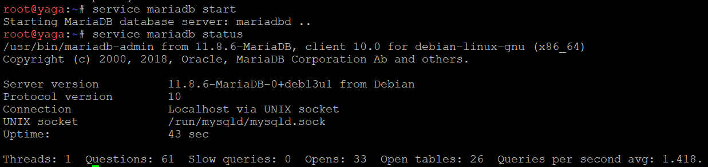

3. Lanjut dengan mengubah bind-address dan mengaktifkan binary logging
`nano /etc/mysql/mariadb.conf.d/50-server.cnf`
```
bind-address = 0.0.0.0

[mysqld]
server-id = 1
log_bin = /var/log/mysql/mariadb-bin.log
binlog_do_db = db_shibuya_k32
```
`bind-address = 0.0.0.0` membuat inumaki bisa terhubung dari node lain. Lalu kita kasih identitas untuk yaga `server-id = 1`. Lanjut buat pencatatan perubahan database ke file binary log yang akan dibaca slave untuk menyalin perubahan dari master menggunakan `log_bin`. pencatatan replikasi ada di database `db_shibuya_k32`.

4. Selanjutnya kita restart layanan MariaDB
```
# 1. Buat direktori untuk log mysql secara manual
mkdir -p /var/log/mysql

# 2. Berikan izin kepemilikan kepada user mysql
chown -R mysql:mysql /var/log/mysql

service mariadb restart
```

5. Pada console MariaDB kita membuat database, tabel, dan hak akses remote bagi seluruh node di Network 4, serta membuat akun khusus replikasi untuk inumaki
`mariadb -u root`

```
CREATE DATABASE db_shibuya_k32;

CREATE USER 'k32'@'192.227.4.%' IDENTIFIED BY 'password123';
GRANT ALL PRIVILEGES ON db_shibuya_k32.* TO 'k32'@'192.227.4.%';

CREATE USER 'replica_user'@'%' IDENTIFIED BY 'password123';
GRANT REPLICATION SLAVE ON *.* TO 'replica_user'@'%';

FLUSH PRIVILEGES;

USE db_shibuya_k32;
CREATE TABLE request_logs (
    id INT AUTO_INCREMENT PRIMARY KEY,
    log_text VARCHAR(255) NOT NULL,
    created_at TIMESTAMP DEFAULT CURRENT_TIMESTAMP
);
```

6. Terakhir kita cek status posisi binary log Master
```
SHOW MASTER STATUS;
```
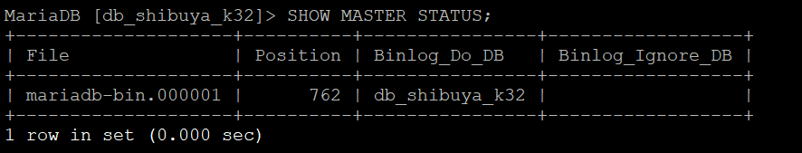

nilai 762 menunjukkan posisi di dalam file yang jadi nilai awal slave membaca perubahan. Setiap ada perubahan di master, nilainya berubah.

### Node inumaki
1. Sama seperti di node yaga kita instal MariaDB
```
apt-get update -y
apt-get install -y mariadb-server mariadb-client
```

2. Lanjut konfigurasi MariaDB
`nano /etc/mysql/mariadb.conf.d/50-server.cnf`

```
bind-address = 0.0.0.0

[mariadbd]
server-id = 2
```

Disini id slave adalah 2.

3. Masuk ke console MariaDB Slave dan hubungkan replikasi ke yaga
`mariadb -u root`
```
CHANGE MASTER TO
    MASTER_HOST = '192.227.4.9',
    MASTER_USER = 'replica_user',
    MASTER_PASSWORD = 'password123',
    MASTER_LOG_FILE = 'mariadb-bin.000001',
    MASTER_LOG_POS = 1846;

START SLAVE;
```

Disini kita mengatur agar inumaki bisa menyalin dari yaga.

4. Dilanjut dengan verifikasi Replikasi
```
SHOW SLAVE STATUS\G
```
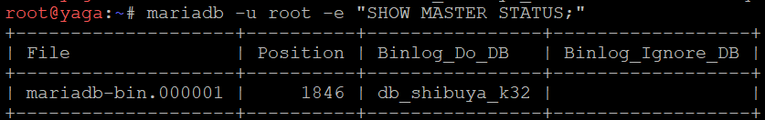

### Uji Pengiriman Data
1. node yaga memasukan data baru
```
mariadb -u root -e "USE db_shibuya_k32; INSERT INTO request_logs (log_text) VALUES ('Uji coba replikasi data baru berhasil');"
```

2. node inumaki cek hasil
```
mariadb -u root -e "USE db_shibuya_k32; SELECT * FROM request_logs;"
```
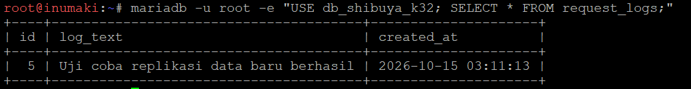

Disini terlihat inumaki berhasil menampilkan tabel pengujian yang dibuat yaga.

---

## Nomor 14
Para penyihir lapangan bersiaga di Data Center sebagai pekerja backend untuk memproses aplikasi. Pasang Nginx dan PHP-FPM pada maki dan panda untuk menyajikan web frontend yang menampilkan hostname masing-masing. Pada nanami, todo, dan kirara, siapkan layanan API yang mencatat log request ke database yaga. Konfigurasikan virtual host agar worker merespons domain layanan yang ditentukan. Batasi akses langsung dari klien ke worker, web worker hanya menerima trafik melalui jalur proxy web yang ditentukan, sedangkan worker API hanya menerima trafik melalui geto. Uji bahwa akses langsung dari klien ditolak, sementara akses melalui reverse proxy tetap berhasil.

### Node maki dan panda
Disini node maki sebagai web frontend
1. Pertama kita instal Nginx dan PHP-FPM
```
apt-get update
apt-get install nginx php-fpm -y
```

2. Lalu kita buat file index.php
`nano /var/www/html/index.php`
```
<!DOCTYPE html>
<html>
<body>
    <h1>Halo, request Anda dilayani oleh worker: <?php echo gethostname(); ?></h1>
</body>
</html>
```
Kita masukkan kode web sederhana yang otomatis memanggil nama hostname server

3. Selanjutnya kita konfigurasi Nginx agar bisa menjalankan PHP
Kita edit file konfigurasi `nano /etc/nginx/sites-available/default`

- Cari baris index index.html index.html ... dan tambahkan `index.php` di  paling depan.
```
index index.php index.html index.htm index.nginx-debian.html;
```

- Cari blok `location ~ \.php$` untuk mengaktifkan PHP-FPM
```
location ~ \.php$ {
    include snippets/fastcgi-php.conf;
    fastcgi_pass unix:/run/php/php8.4-fpm.sock; 
}
```

- ubah baris `server_name _;` menjadi `web.jujutsu.com` lalu tambahkan aturan IP gojo (192.227.1.4) di bawahnya.

4. Dilanjut untuk uji konfigurasi yang sudah kita buat
```
nginx -t
service nginx restart
service php8.4-fpm restart
```

5. Lalu kita uji di halaman web
```
lynx http://localhost
```
- di maki


- di panda
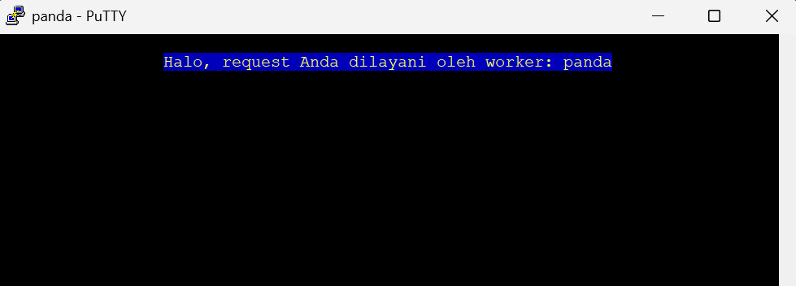

Terlihat bahwa web terlihat dengan hostname sesuai node dijalankan

### Node nanami, todo, dan kirara
Node nanami ini haarus bisa berkomunikasi dengan server database MariaDB di yaga untuk bisa mengirim data insert ke tabel request_logs.

1. Instal Nginx, PHP-FPM, dan Ekstensi MySQL
```
apt-get update
apt-get install nginx php-fpm php-mysql -y
```

2. Buat File API PHP
`nano /var/www/html/index.php`
```
<?php
$host = '192.227.4.9'; // IP DB Master yaga
$db   = 'db_shibuya_k32';
$user = 'k32';
$pass = 'password123';
$worker = gethostname();

$log_text = "API Request diterima dan diproses oleh worker: " . $worker;

try {
    // Membuat koneksi ke database yaga
    $pdo = new PDO("mysql:host=$host;dbname=$db", $user, $pass);
    $pdo->setAttribute(PDO::ATTR_ERRMODE, PDO::ERRMODE_EXCEPTION);
    
    // Menyimpan log ke tabel request_logs
    $stmt = $pdo->prepare("INSERT INTO request_logs (log_text) VALUES (:log_text)");
    $stmt->bindParam(':log_text', $log_text);
    $stmt->execute();
    
    echo "<h1>Sukses!</h1>";
    echo "<p>$log_text. Log telah berhasil dicatat ke database yaga.</p>";
} catch(PDOException $e) {
    echo "Koneksi/Insert Gagal: " . $e->getMessage();
}
?>
```
kode ini akan menyambung ke IP yaga 192.227.4.9 dengan user k32.

3. Konfigurasi Nginx
`nano /etc/nginx/sites-available/default`
- Tambahkan index.php di baris index
```
index index.php index.html index.htm index.nginx-debian.html;
```

- Cari blok `location ~ \.php$` untuk mengaktifkan PHP-FPM
```
location ~ \.php$ {
    include snippets/fastcgi-php.conf;
    fastcgi_pass unix:/run/php/php8.4-fpm.sock; 
}
```

- ubah baris `server_name _;` menjadi nama domain layanan API, dan masukkan aturan IP geto (192.227.4.3)
```
server_name api.jujutsu.com;
allow 192.227.4.3;
deny all;
```

4. Lanjut dengan restart layanan dan uji coba
```
nginx -t
service nginx restart
service php8.4-fpm restart
```

5. Terakhir kita pembuktian
- pada nanami, todo, dan kirara
```
curl http://localhost
```
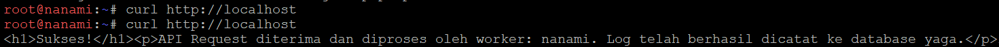

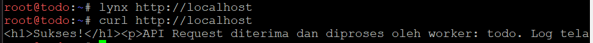

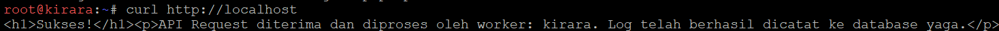

kita kirim request dan data dikirim ke yaga 
- pada inumaki
```
mariadb -u root -e "USE db_shibuya_k32; SELECT * FROM request_logs;"
```
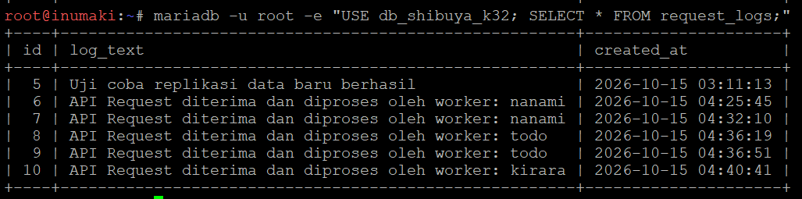

request berhasil diterima inumaki.

### Pengujian Akses melalui reverse proxy tetap berhasil
- dari node gojo Untuk Web Worker
```
curl http://192.227.4.4
curl http://192.227.4.5
```
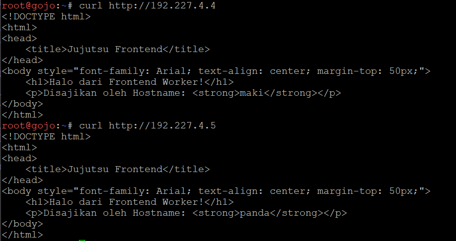


- dari node geto Untuk API Worker
```
curl http://192.227.4.6
curl http://192.227.4.7
```
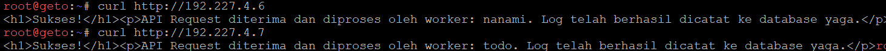

lalu diterima oleh yaga
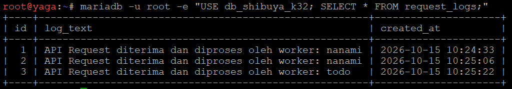

---

## Nomor 15
Geto bertugas mengendalikan pembagian beban request API di internal Data Center agar server tidak tumbang bersamaan. Konfigurasikan Nginx pada geto sebagai Load Balancer internal dengan upstream api_cluster yang mengarahkan trafik ke nanami dan todo. Terapkan algoritma Weighted Round Robin dengan bobot 3:1, di mana nanami menerima porsi beban tiga kali lebih banyak daripada todo. Buktikan distribusi beban ini dengan melakukan loop request berulang kali ke geto dari jaringan lokal Data Center dan periksa rasio responnya.

### Node geto
1. Pertama, kita update dan Instal Nginx di geto
```
apt-get update -y
apt-get install -y nginx
```

2. Lalu buat daftar Blok Upstream
`nano /etc/nginx/sites-available/default`
kita mendaftarkan IP dari nanami dan todo
```
upstream api_cluster {
    server 192.227.4.6 weight=3;
    server 192.227.4.7 weight=1;
}
```
Kita tetapkan jika ada 4 request masuk, maka 3 request ditujukan untuk nanami dan 1 request untuk todo.

3. Lalu arahkan semua request ke Blok Server
```
server {
    listen 80 default_server;
    server_name api.jujutsu.com _;

    location / {
        proxy_pass http://api_cluster;
    }
}
```

Setiap ada yang akses domain api.jujutsu.com atau IP geto, nginx akan meneruskannya ke grup api_cluster.

4. Setelah itu kita terapkan konfigurasinya
```
nginx -t
service nginx restart
```

5. Uji Loop Request
```
for i in {1..8}; do curl -s http://192.227.4.3 | grep "diproses oleh worker"; done
```
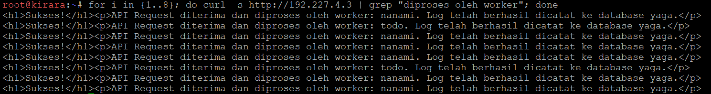

disini nanami merespons sebanyak 6 kali, dan todo merespons sebanyak 2 kali.

---

## Nomor 16
Gojo berdiri di perbatasan DMZ sebagai gerbang publik tunggal bagi seluruh client dari luar maupun dalam. Konfigurasikan Nginx pada gojo untuk melayani domain jujutsu.<xxxx>.com dan www.jujutsu.<xxxx>.com menggunakan metode Path-Based Routing. Atur agar request root (/) diteruskan secara Round Robin ke worker frontend (maki dan panda), sedangkan request ke path /api diteruskan langsung ke geto. Uji dari client Divisi A atau B bahwa akses ke web utama dibalas oleh Maki/Panda, sedangkan akses ke /api diteruskan dan dijawab oleh Nanami/Todo.

### Node gojo
1. Instal Nginx
```
apt-get update -y
apt-get install -y nginx
```

2. Edit Konfigurasi Nginx:
`nano /etc/nginx/sites-available/default`
```
upstream frontend_cluster {
    server 192.227.4.4;
    server 192.227.4.5;
}

server {
    listen 80 default_server;
    server_name jujutsu.com www.jujutsu.com;

    # Jika URL-nya '/' (halaman utama) -> lempar ke Maki/Panda
    location / {
        proxy_pass http://frontend_cluster;
    }

    # Jika URL-nya '/api/' -> lempar ke Geto (192.227.4.3)
    location /api/ {
        proxy_pass http://192.227.4.3/;
    }
}
```
Kita konfigurasikan jika URR nya `/` maka akan diarahkan ke maki/ panda. Jika URL nya `/api/` maka akan diarahkan ke geto dgn IP 192.227.4.3.

3. Lalu kita restart nginx
```
nginx -t
service nginx restart
```

---

## Nomor 17
Komando pusat perlu mengetahui IP asli klien yang mengirimkan request tanpa tertukar dengan IP proxy perantara. Konfigurasikan gojo dan geto agar meneruskan informasi alamat klien melalui header X-Real-IP dan X-Forwarded-For. Pastikan geto hanya mempercayai informasi alamat klien yang diterima dari proxy terpercaya, dan skrip API menyimpan alamat klien yang telah diverifikasi ke kolom client_ip pada tabel request_logs di database yaga. Uji dengan mengirimkan request dari klien Network 2 dan Network 3 ke endpoint /api, kemudian periksa database untuk memastikan alamat yang tercatat sesuai dengan IP klien asal, bukan IP gojo atau geto.

### Node gojo
Disini gojo sebagai reverse proxy
1. Konfigurasi reverse proxy
`nano /etc/nginx/sites-available/default`
ubah bagian `location /` dan `location /appi/` pastikan ada baris penangkap IP
```
location /api/ {
    proxy_pass http://192.227.4.3/;
    proxy_set_header Host $host;
    proxy_set_header X-Real-IP $remote_addr;
    proxy_set_header X-Forwarded-For $proxy_add_x_forwarded_for;
}
```

2. Lalu restarr nginx
```
nginx -t
service nginx restart
```

### Node geto
Node geto sebagai load balencer
1. Konfigurasikan load balancer
`nano /etc/nginx/sites-available/default`
```
server {
    listen 80 default_server;

    # Percayai IP Gojo
    set_real_ip_from 192.227.1.4;
    real_ip_header X-Forwarded-For;

    location / {
        proxy_pass http://api_cluster;
        proxy_set_header Host $host;
        proxy_set_header X-Real-IP $remote_addr;
        proxy_set_header X-Forwarded-For $proxy_add_x_forwarded_for;
    }
}
```

2. Restart nginx
```
nginx -t
service nginx restart
```

### Node yaga
Pada node yaga kita tambahkan kolom untuk menyimpan alamat IP
```
USE db_shibuya_k32;
ALTER TABLE request_logs ADD COLUMN client_ip VARCHAR(50);
```

### Node nanami dan todo
disini nanami dan todo berperan sebagai worker diperbarui dgn logika pemisah koma agar IP asli klien tidak tertimpa proxy 
```
<?php
$host = '192.227.4.9'; // IP Master yaga
$db   = 'db_shibuya_k32';
$user = 'k32';
$pass = 'password123';
$worker = gethostname();

// Tangkap IP dari rantai proxy
if (!empty($_SERVER['HTTP_X_FORWARDED_FOR'])) {
    $ip_list = explode(',', $_SERVER['HTTP_X_FORWARDED_FOR']);
    $client_ip = trim($ip_list[0]); 
} elseif (!empty($_SERVER['HTTP_X_REAL_IP'])) {
    $client_ip = $_SERVER['HTTP_X_REAL_IP'];
} else {
    $client_ip = $_SERVER['REMOTE_ADDR'];
}

$log_text = "API Request diterima dan diproses oleh worker: " . $worker;

try {
    $pdo = new PDO("mysql:host=$host;dbname=$db", $user, $pass);
    $pdo->setAttribute(PDO::ATTR_ERRMODE, PDO::ERRMODE_EXCEPTION);

    $stmt = $pdo->prepare("INSERT INTO request_logs (log_text, client_ip) VALUES (:log_text, :client_ip)");
    $stmt->bindParam(':log_text', $log_text);
    $stmt->bindParam(':client_ip', $client_ip);
    $stmt->execute();

    echo "<h1>Sukses!</h1><p>$log_text. Log dengan IP $client_ip telah dicatat.</p>";
} catch(PDOException $e) {
    echo "Gagal: " . $e->getMessage();
}
?>
```

---

## Nomor 18
nanami dan todo merupakan worker API utama, sedangkan kirara isiapkan sebagai worker cadangan. Konfigurasikan upstream api_cluster pada geto agar kirara menjadi server backup, serta terapkan passive health check dengan parameter max_fails=2 dan fail_timeout=5s pada worker API utama. Pastikan kirara menjalankan layanan API yang kompatibel dengan endpoint utama. Simulasikan gangguan dengan menghentikan layanan Nginx atau layanan API pada nanami dan todo. Buktikan dari klien bahwa request ke /api dialihkan ke kirara dan menghasilkan respons API yang valid tanpa error 502 Bad Gateway.

### Node kirara
1. Menyiapkan API cadangan
`nano /var/www/html/index.php`
```
<?php
$host = '192.227.4.9'; // IP Master yaga
$db   = 'db_shibuya_k32';
$user = 'k32';
$pass = 'password123';
$worker = gethostname();

// Tangkap IP dari rantai proxy (sama seperti nanami/todo)
if (!empty($_SERVER['HTTP_X_FORWARDED_FOR'])) {
    $ip_list = explode(',', $_SERVER['HTTP_X_FORWARDED_FOR']);
    $client_ip = trim($ip_list[0]); 
} elseif (!empty($_SERVER['HTTP_X_REAL_IP'])) {
    $client_ip = $_SERVER['HTTP_X_REAL_IP'];
} else {
    $client_ip = $_SERVER['REMOTE_ADDR'];
}

// Tambahkan kata "CADANGAN" agar kita gampang bedain pas dites
$log_text = "API Request diterima dan diproses oleh worker CADANGAN: " . $worker;

try {
    $pdo = new PDO("mysql:host=$host;dbname=$db", $user, $pass);
    $pdo->setAttribute(PDO::ATTR_ERRMODE, PDO::ERRMODE_EXCEPTION);

    $stmt = $pdo->prepare("INSERT INTO request_logs (log_text, client_ip) VALUES (:log_text, :client_ip)");
    $stmt->bindParam(':log_text', $log_text);
    $stmt->bindParam(':client_ip', $client_ip);
    $stmt->execute();

    echo "<h1>Sukses!</h1><p>$log_text. Log dengan IP $client_ip telah dicatat.</p>";
} catch(PDOException $e) {
    echo "Gagal: " . $e->getMessage();
}
?>
```
Diawal berisi alamat Yaga sebagai server database, nama database, dan akun yang digunakan untuk terhubung. `gethostname()` mengambil nama node yang sedang menjalankan API, sehingga respons dan catatan log menunjukkan bahwa request diproses oleh Kirara. Lalu mengambil IP asli client dari  `X-Forwarded-For` atau `X-Real-IP`, jika header tersebut tidak tersedia kode menggunakan alamat koneksi langsung dari `REMOTE_ADDR`.Selanjutnya `request_logs` menyimpan informasi worker dan IP client.

### Node geto
Disni node geto sebagai load balancer
1. Konfigurasi load balencer
`nano /etc/nginx/sites-available/default`
ubah blok `upstream api_cluster { ... }`

```
upstream api_cluster {
    # Worker utama dengan health check
    server 192.227.4.6 weight=3 max_fails=2 fail_timeout=5s; 
    server 192.227.4.7 weight=1 max_fails=2 fail_timeout=5s; 

    # Worker cadangan
    server 192.227.4.8 backup; # IP Kirara
}
```

3. Uji dan restart nginx
```
nginx -t
service nginx restart
```

4. Simulasi gangguan
untuk ini kita matikan nanami dan todo
```
service nginx stop
```
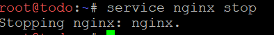

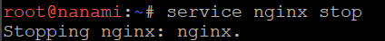

5. Lalu kita buktian dari Klien (miwa)
```
curl -H "Host: jujutsu.com" http://192.227.1.4/api/
```
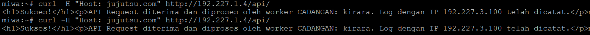

---

## Soal 19
gojo bertugas mengoptimalkan layanan web sekaligus membatasi request berlebihan. Konfigurasikan Nginx Proxy Caching untuk halaman web frontend dengan masa berlaku cache 10 menit dan tambahkan header X-Cache-Status. Terapkan rate limiting pada path /api dengan batas 10 request per detik per IP klien. Buktikan bahwa request ke halaman web yang memenuhi syarat cache menghasilkan status MISS pada akses awal dan HIT pada akses berikutnya. Uji rate limiting secara terpisah dengan mengirimkan request beruntun ke /api, kemudian catat status respons yang dihasilkan ketika batas terlampaui

### Node gojo
1. kita konfigurasi nginx.
`/etc/nginx/sites-available/default`
```
proxy_cache_path /var/cache/nginx levels=1:2 keys_zone=web_cache:10m inactive=10m use_temp_path=off;
limit_req_zone $binary_remote_addr zone=api_limit:10m rate=10r/s;

upstream frontend_cluster {
    server 192.227.4.4; # IP Maki
    server 192.227.4.5; # IP Panda
}

server {
    listen 80 default_server;
    server_name jujutsu.com www.jujutsu.com;

    location / {
        proxy_pass http://frontend_cluster;
        proxy_set_header Host $host;
        proxy_set_header X-Real-IP $remote_addr;
        proxy_set_header X-Forwarded-For $proxy_add_x_forwarded_for;

        # Eksekusi Cache Frontend
        proxy_cache web_cache;
        proxy_cache_valid 200 302 10m;
        add_header X-Cache-Status $upstream_cache_status;
    }

    location /api/ {
        proxy_pass http://192.227.4.3/;
        proxy_set_header Host $host;
        proxy_set_header X-Real-IP $remote_addr;
        proxy_set_header X-Forwarded-For $proxy_add_x_forwarded_for;

        # Eksekusi Rate Limit API
        limit_req zone=api_limit;
    }
}
```
disini kita menetapkan maki dan panda sebagai server frontend dengan membagi request ke keduanya. `proxy_cache_path` menyiapkan tempat penyimpanan cache,  `proxy_cache_valid` mengatur agar respons sukses (200) dan pengalihan (302) bisa digunakan kembali selama 10 menit.  `X-Cache-Status` mastiin apakah respons berasal dari cache.

`location /` meneruskan request halaman web ke frontend. `Host`, `X-Real-IP`, dan `X-Forwarded-For` juga dikirim agar backend mengetahui domain yang diminta dan alamat client. 

`location /api/` meneruskan request API ke server `192.227.4.3`. `limit_req_zone` dan `limit_req` membatasi laju request API 10 request per detik tiap alamat IP client.

2. Lalu kita test nginx dan restart
```
mkdir -p /var/cache/nginx
nginx -t && service nginx restart
```

## Soal 20
Sebelum Curtain di Shibuya resmi dibuka, Kusakabe memimpin audit untuk menguji kapasitas layanan. Dari terminal kusakabe, jalankan benchmark menggunakan Apache Benchmark dengan parameter -n 600 -c 30 menuju http://jujutsu.<xxxx>.com/. Catat Requests per Second (RPS), latensi, dan jumlah request yang gagal. Lakukan pengujian tambahan pada endpoint /api untuk mengamati efek rate limiting. Bandingkan hasil pengujian baseline dengan hasil ketika rate limiting aktif, serta gunakan access log gojo untuk membedakan kegagalan aplikasi, koneksi, dan request yang ditolak oleh kebijakan rate limit.

### Node kusukabe
1. Memperbaiki DNS untuk akses internet
`/etc/resolv.conf`
```
nameserver 8.8.8.8
```

2. Menginstal apache benchmark
```
apk update
apk add apache2-utils
```

3. Mendaftarkan domain ke file hosts
Pertama kita cek agar tidak terjadi duplikat penulisan di `/etc/hosts`
```
if ! grep -q "jujutsu.com" /etc/hosts; then
    echo "192.227.1.4 jujutsu.com www.jujutsu.com" >> /etc/hosts
    echo "Domain jujutsu.com berhasil ditambahkan ke /etc/hosts"
else
    echo "Domain jujutsu.com sudah ada di /etc/hosts"
```

4. dilanjut dengan melakukan pengujian
- baseline (\frontend: / )
```
ab -n 600 -c 30 http://jujutsu.com/
```
- rate limiting (/api/)
```
ab -n 600 -c 30 http://jujutsu.com/api/
```

## Kendala & Solusi

| Kendala | Penyebab | Solusi |
|---|---|---|
| Error *Permission denied (privilege Project.Allocate is required)* di GNS3 | Akun yang dipakai tidak memiliki hak akses ke project | Login dengan akun kelompok yang memiliki akses ke project |
| Node menyala tanpa IPv4 (hanya `fe80::`) | `/etc/network/interfaces` masih berupa template bawaan yang seluruhnya dikomentari | IP dipasang melalui `soal1.sh`, dan dijalankan otomatis oleh autostart |
| Server tidak bisa menginstal paket setelah GNS3 dibuka ulang | jichi belum dikonfigurasi, sehingga gateway Network 4 tidak ada | Selalu konfigurasi jichi lebih dulu; autostart di tengen menunggu koneksi internet sebelum menginstal |
| Client `broadcasting discover` tanpa balasan pada pengujian soal 3 | jichi belum aktif kembali setelah restart, dan relay belum menandai interface upstream | Relay dijalankan dengan `-id eth2 -id eth3 -iu eth4` |
| `search k32.com` tidak muncul di client | `udhcpc` tidak meminta opsi 119 secara default | `udhcpc` dijalankan dengan `-O search -O domain` |
| Paste script panjang di PuTTY menjadi acak | Buffer terminal tidak sanggup menampung paste besar | Paste satu blok per kali, dan tunggu prompt kembali sebelum paste blok berikutnya |
| Autostart tidak berjalan setelah restart | `iface lo inet loopback` gagal di busybox `ifup`, sehingga hook `up` dilewati | Diganti menjadi `iface lo inet manual` |
| Tabel `cek7.sh` kosong setelah restart | File lease ikut kosong karena container dibuat ulang | Client diminta mengambil lease ulang sebelum pemeriksaan |
